# CloudSupportGraph

> **面向云服务的智能分诊与工单协作系统**  
> 基于 **FastAPI + LangGraph (`AsyncSqliteSaver` / `interrupt()`) + FastMCP + SQLite FTS5 + React 18** 构建的轻量化、高可控云产品技术支持与人机协同工单平台。

[](https://www.python.org/)
[](https://fastapi.tiangolo.com/)
[](https://github.com/langchain-ai/langgraph)
[](https://modelcontextprotocol.io/)
[](https://react.dev/)
[](#实测与评测基准)

---

## 🎬 功能演示视频

> 以下演示均录制于生产安全模式（`ENABLE_DEMO_LOGIN=false`，1080P / 30fps，内嵌中文字幕）。下滑可直接观看动态预览，点击预览图或链接可打开对应 **1080P 完整原画 MP4**。

### 主链路闭环演示（登录 → 知识问答溯源 → 故障诊断挂起 → 坐席批单 → 客户看单 → 管理员 Trace）

[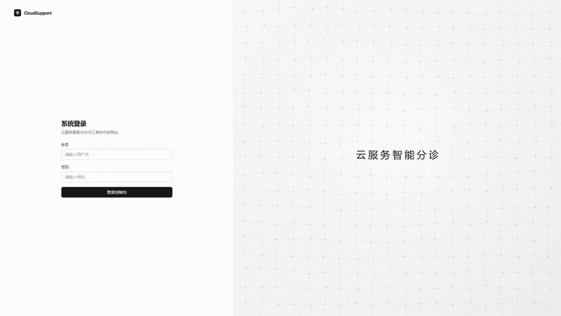](docs/report-assets/演示视频/01-主链路闭环-登录到建单-1080P.mp4)

> 📹 完整版原画（1:24 · 1080P）：[01-主链路闭环-登录到建单-1080P.mp4](docs/report-assets/演示视频/01-主链路闭环-登录到建单-1080P.mp4)

### 分功能演示短片（点击展开即时动态预览）

<details>
<summary><b>02 · 拒答与安全边界</b>（0:41）— 知识库未覆盖严格拒答 / 提示注入前置拦截 / 越权探测拒绝 / 高危操作转人工挂起</summary>
<br/>

[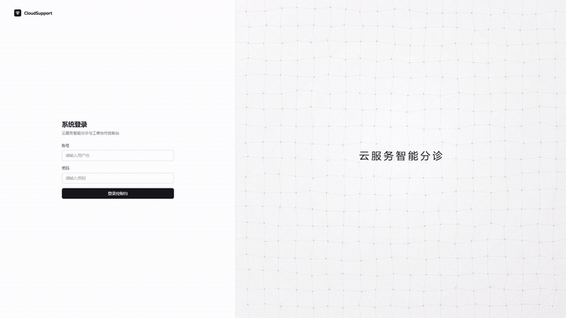](docs/report-assets/演示视频/分功能短片/02-拒答与安全边界-1080P.mp4)

📹 1080P 原画：[02-拒答与安全边界-1080P.mp4](docs/report-assets/演示视频/分功能短片/02-拒答与安全边界-1080P.mp4)
</details>

<details>
<summary><b>03 · 多模态报错截图排障</b>（0:37）— PNG/JPEG/WebP 魔数校验 / 视觉提取报错信息 / 严格拒答保护 / Bearer 鉴权附件回看</summary>
<br/>

[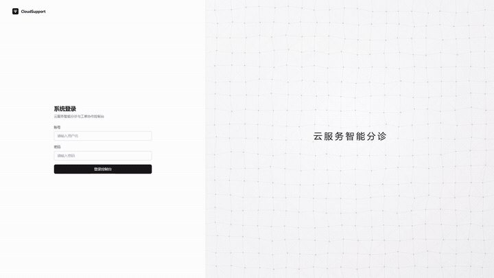](docs/report-assets/演示视频/分功能短片/03-多模态报错截图-1080P.mp4)

📹 1080P 原画：[03-多模态报错截图-1080P.mp4](docs/report-assets/演示视频/分功能短片/03-多模态报错截图-1080P.mp4)
</details>

<details>
<summary><b>04 · 坐席接管与工单状态机</b>（0:39）— 待接管队列 / 仅接管不建单 / 人工回复客户 / 工单五态流转与 409 非法跃迁拦截</summary>
<br/>

[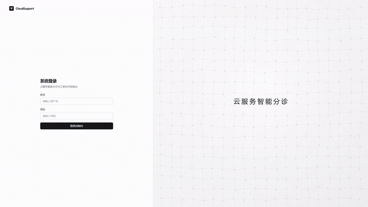](docs/report-assets/演示视频/分功能短片/04-坐席接管与工单状态机-1080P.mp4)

📹 1080P 原画：[04-坐席接管与工单状态机-1080P.mp4](docs/report-assets/演示视频/分功能短片/04-坐席接管与工单状态机-1080P.mp4)
</details>

<details>
<summary><b>05 · 多租户隔离与 RBAC 鉴权</b>（0:28）— 租户云实例隔离 / 越权访问 `/admin` 拦截 / 常规实例诊断直答 / 工单租户隔离</summary>
<br/>

[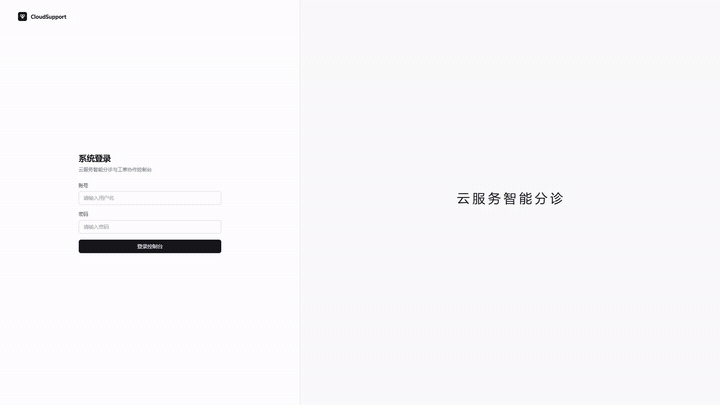](docs/report-assets/演示视频/分功能短片/05-租户隔离与RBAC-1080P.mp4)

📹 1080P 原画：[05-租户隔离与RBAC-1080P.mp4](docs/report-assets/演示视频/分功能短片/05-租户隔离与RBAC-1080P.mp4)
</details>

<details>
<summary><b>06 · 管理端观测与 32 题黄金集评测</b>（0:47）— 分源 Trace 看板 / 32 题评测明细 / jieba+BM25 阈值调参 / 实例故障靶场</summary>
<br/>

[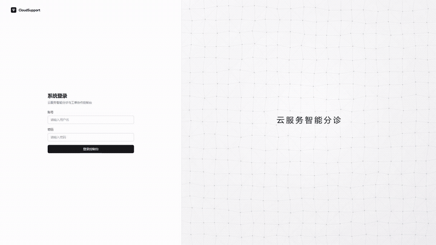](docs/report-assets/演示视频/分功能短片/06-管理端观测与评测-1080P.mp4)

📹 1080P 原画：[06-管理端观测与评测-1080P.mp4](docs/report-assets/演示视频/分功能短片/06-管理端观测与评测-1080P.mp4)
</details>

<details>
<summary><b>07 · 接口文档与 OpenAPI 3.1 契约</b>（0:42）— Swagger UI 在线分组调试 / ReDoc 契约阅读 / OpenAPI JSON 导出 / 健康检查</summary>
<br/>

[](docs/report-assets/演示视频/分功能短片/07-接口文档与API契约-1080P.mp4)

📹 1080P 原画：[07-接口文档与API契约-1080P.mp4](docs/report-assets/演示视频/分功能短片/07-接口文档与API契约-1080P.mp4)
</details>

---

## 🖼️ 系统界面一览

<table>
  <tr>
    <td align="center" width="50%">
      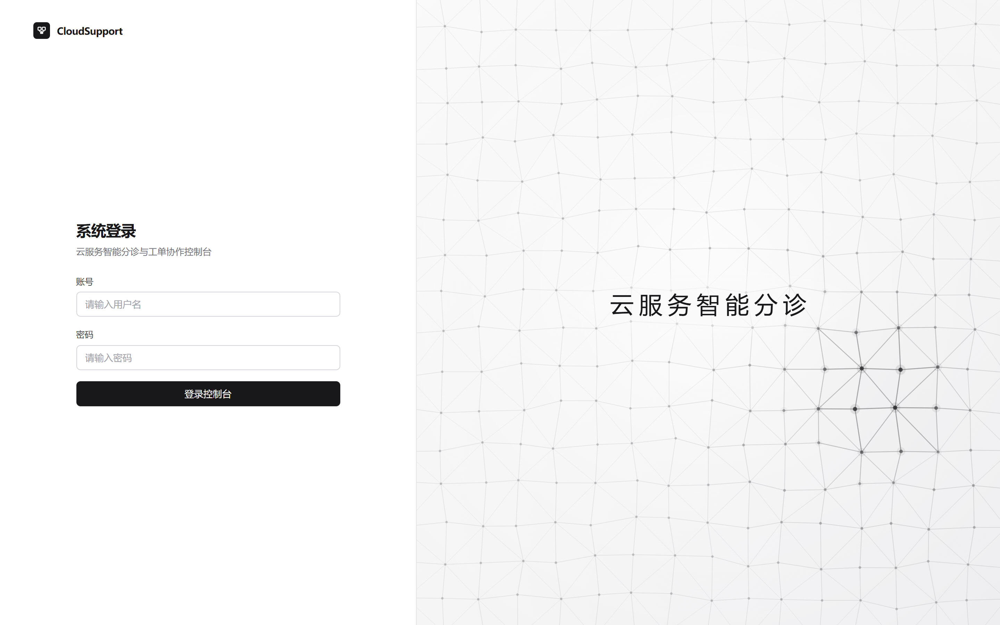<br/>
      <b>生产安全登录页</b>（<code>ENABLE_DEMO_LOGIN=false</code>）
    </td>
    <td align="center" width="50%">
      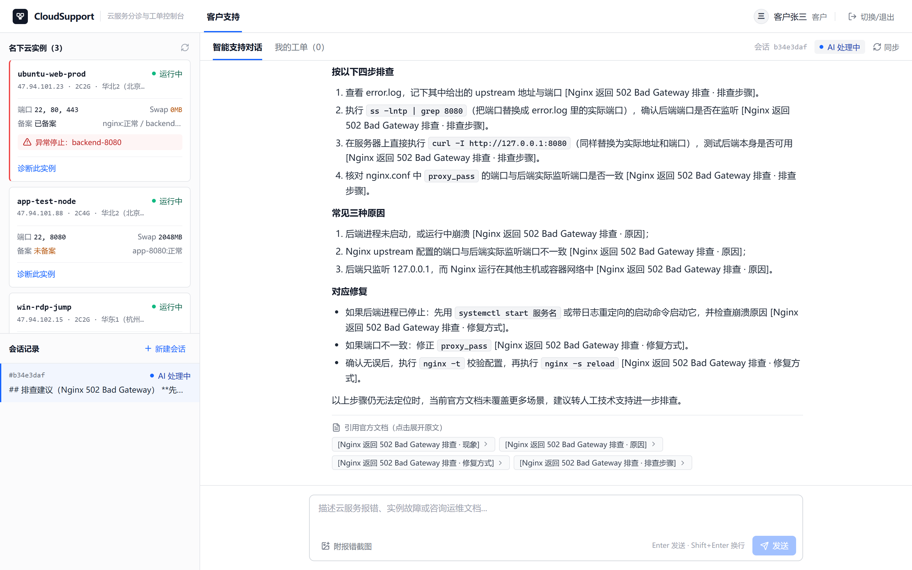<br/>
      <b>客户支持工作台</b>（云实例告警 + SSE 流式问答 + 原文引用溯源）
    </td>
  </tr>
  <tr>
    <td align="center" width="50%">
      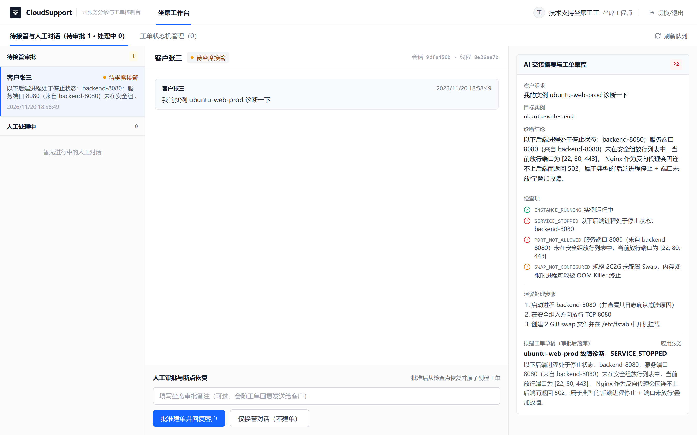<br/>
      <b>人工坐席协同工作台</b>（待审批队列 + AI 交接摘要 + 一键断点恢复建单）
    </td>
    <td align="center" width="50%">
      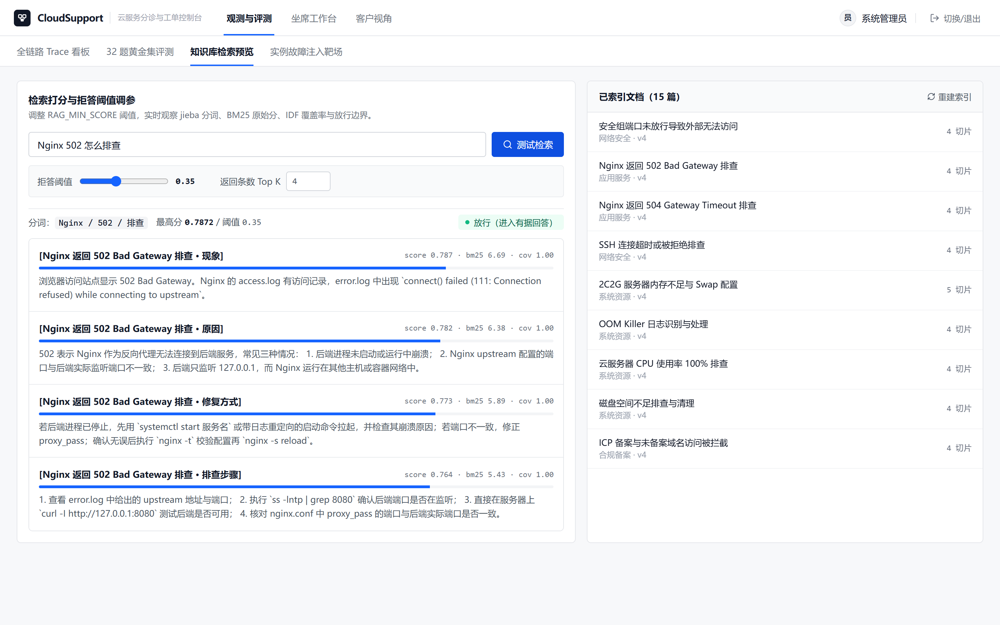<br/>
      <b>管理端知识库调参</b>（实时观察 jieba 分词、BM25、覆盖率与拒答阈值）
    </td>
  </tr>
  <tr>
    <td align="center" width="50%">
      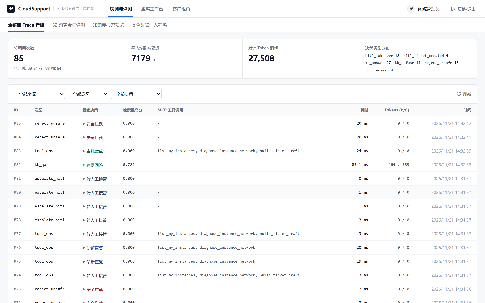<br/>
      <b>全链路 Trace 看板</b>（评测流量与真实流量分源统计、工具调用与 Token 追踪）
    </td>
    <td align="center" width="50%">
      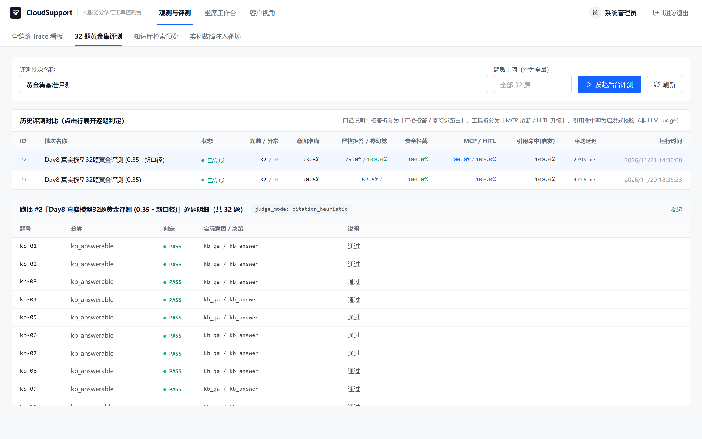<br/>
      <b>32 题黄金集评测看板</b>（多批次指标对比 + 逐题判定明细）
    </td>
  </tr>
</table>

---

## ✨ 核心特性

- **确定性业务与概率性智能体解耦**：JWT + RBAC 三层权限隔离（401 令牌 / 403 角色 / 404 防枚举）与五态工单有限状态机（`OPEN → TRIAGED → IN_PROGRESS → RESOLVED → CLOSED`）由确定性后端代码与 SQLite 约束严格保障，非法跃迁返回 `409` 且零库污染。
- **架构级防越权 MCP 工具调用**：基于 FastMCP（进程内内存传输）提供 4 个受控云资产诊断与草稿工具；服务侧签发 120 s 短时效 HMAC-SHA256 身份上下文令牌并通过闭包注入，`user_id` 完全不出现在大模型可见的工具 Schema 中，跨租户或不存在实例统一返回 `PERMISSION_DENIED`。
- **可持久化人机协同（HITL）闭环**：基于 LangGraph 10 节点状态图与独立 `checkpoints.db`（`AsyncSqliteSaver`），高危诊断自动触发 `interrupt()` 挂起并生成交接摘要与工单草稿；坐席审批通过 `Command(resume=...)` 从断点恢复（支持跨进程重启恢复），配合会话互斥锁、数据库 CAS 与活跃工单部分唯一索引确保并发审批幂等建单。
- **亚毫秒级中文检索与零幻觉拒答**：结合 `jieba.cut_for_search` 预分词与 SQLite FTS5 BM25，融合 IDF 加权覆盖率、标题命中率与未收录英数技术标识符 `0.30` 封顶硬约束；在标定阈值 `RAG_MIN_SCORE = 0.35` 下兼顾原文溯源与低分严格拒答，检索均值仅 `0.35 ms`。
- **2 核 2 GiB 轻量化生产架构**：双容器（FastAPI + Nginx）+ 双 SQLite WAL 库分离，后端空闲常驻内存实测仅 `39.46 MiB`；支持多模态报错截图魔数校验与 `<untrusted_screenshot_ocr>` 隔离标签防间接提示注入。

---

## 🏗️ 系统架构

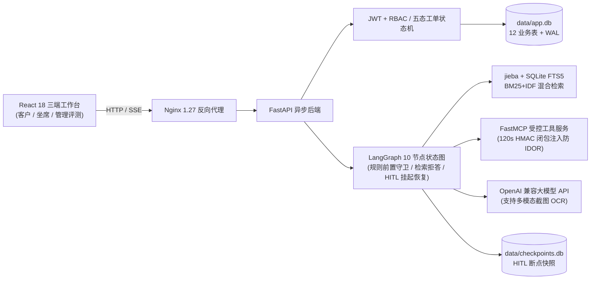

### 技术栈

| 层次 | 核心选型 |
|---|---|
| 后端服务 | Python 3.12 · FastAPI · Pydantic v2 · SQLite (WAL + FTS5) · `jieba` · `PyJWT` · `bcrypt` |
| 智能编排与工具 | LangGraph (`langgraph-checkpoint-sqlite`) · LangChain · FastMCP (`mcp`) · OpenAI 兼容推理接口 |
| 前端工作台 | React 18 · TypeScript 5 · Vite 6 · Tailwind CSS 3 · `react-markdown` · `lucide-react` |
| 质量保障与部署 | `pytest` · Playwright E2E · 32 题黄金集自动化评测 · Docker Compose + Nginx |

---

## 📊 实测与评测基准

| 维度 | 核心指标 | 实测结果 |
|---|---|---|
| 自动化测试 | 后端分层单元测试 + 审计专项回归（离线确定性） | **182 / 182 passed**（0 failed / 0 skipped） |
| 端到端测试 | Playwright 真实浏览器（`ENABLE_DEMO_LOGIN=false`） | **3 / 3 passed**（20.50 s） |
| 检索性能与准确率 | `jieba` + SQLite FTS5（`RAG_MIN_SCORE = 0.35`） | 检索层准确率 **100.0%**，平均延迟 **0.35 ms**（P95 0.63 ms） |
| 32 题黄金评测集 | 真实大模型端到端评测（`DeepSeek-V4.1-Flash-1017`） | 严格通过率 **93.8% (30/32)** · 零幻觉安全路由率 **100.0%** |
| 安全与工具防线 | 规则前置安全拦截 / MCP 工具调用 / 引用命中率 | 均为 **100.0%**（安全对抗 0 Token，63–105 ms 拦截） |
| 资源占用 | 阿里云 2 核 2 GiB 容器实测（`docker stats`） | 后端空闲常驻 **39.46 MiB** · CPU **0.17%** · 启动 `< 12 s` |

---

## 🚀 快速开始

### 1. 本地开发运行

```powershell
# 1. 复制环境变量模板，填入强随机 JWT_SECRET（>=32 字节）与大模型 API 配置
#    仅本地开发如需登录页一键体验按钮，可将 ENABLE_DEMO_LOGIN 设为 true
copy .env.example .env

# 2. 创建 Python 3.12 虚拟环境、安装依赖并初始化种子数据（15 篇运维文档 / 58 切片）
cd backend
python -m venv .venv
.\.venv\Scripts\Activate.ps1
pip install -e ".[dev]"
python -m app.db.seed

# 3. 启动后端服务（默认 8000 端口，交互式接口文档位于 /docs 与 /redoc）
uvicorn app.main:app --host 127.0.0.1 --port 8000 --reload

# 4. 另开终端启动前端开发服务器（5173 端口）
cd frontend
npm install
npm run dev
```

### 2. 运行测试与评测

```powershell
cd backend
# 全量后端离线单元测试（夹具自动隔离外部 API，0 费用）
.\.venv\Scripts\python.exe -m pytest -q

# 检索层多阈值 A/B 对比实验（18 题知识库子集）
.\.venv\Scripts\python.exe -m app.eval.ab_threshold --thresholds 0.30,0.35,0.45

# 浏览器端到端冒烟测试（需先启动前后端）
.\.venv\Scripts\python.exe -m pytest ..\e2e\test_e2e_flows.py -v
```

### 3. Docker Compose 生产部署

> 生产启动强制执行安全闸门：`.env` 中必须配置 `APP_ENV=production`、`ENABLE_DEMO_LOGIN=false`、`JWT_SECRET`（≥32 字节强随机）与 `SEED_DEFAULT_PASSWORD`（≥10 位非默认强口令）。

```powershell
# 本地构建前端并打包部署至云主机（支持 -EnableTls -PublicDomain <域名> 启用 HTTPS 443）
powershell -ExecutionPolicy Bypass -File .\deploy\deploy_aliyun.ps1 -ServerHost <YOUR_SERVER_IP> -UploadEnv

# 部署后执行 6 项公网全链路自动化验收
$env:VERIFY_PASSWORD = "<你的生产强口令>"
cd backend
.\.venv\Scripts\python.exe ..\deploy\verify_public.py http://<YOUR_SERVER_IP>
```

---

## 📁 目录结构

```text
cloud-support-graph/
├── backend/                 # FastAPI 后端、LangGraph 状态图、FastMCP 工具、检索与评测
│   ├── app/
│   │   ├── agent/           # 10 节点状态图、规则守卫、工具桥接与 Trace 记录
│   │   ├── auth/            # bcrypt 密码校验、JWT 签发与 RBAC 依赖守卫
│   │   ├── db/              # 12 张业务表 DDL、FTS5 触发器与幂等种子数据
│   │   ├── eval/            # 32 题黄金集评测引擎与阈值 A/B 脚本
│   │   ├── mcp/             # FastMCP 4 个受控诊断/草稿工具与 HMAC 上下文验签
│   │   ├── routers/         # REST 与 SSE 流式接口路由
│   │   └── services/        # 中文检索打分、工单状态机、多模态截图校验与实例诊断
│   └── tests/               # 18 个测试模块，共 182 项自动化单元测试与审计回归
├── frontend/                # React 18 + TypeScript + Vite 三端控制台
├── e2e/                     # Playwright 真实浏览器端到端测试
├── deploy/                  # Dockerfile、Nginx 80/443 反代模板与部署/验收脚本
├── docs/                    # 架构设计规范、实测数据记录与演示素材
└── docker-compose.yml       # 双容器编排配置（backend + nginx）
```
