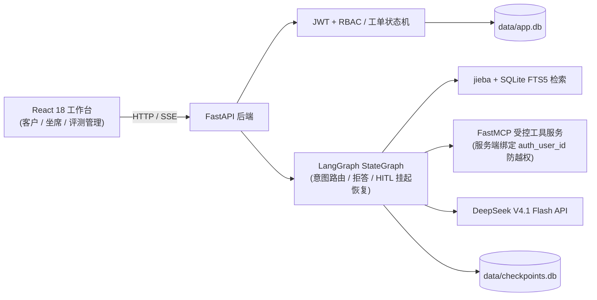

# cloud-support-graph

> **面向云服务的智能分诊与工单协作系统**（`CloudSupportGraph`）  
> 基于 **FastAPI + LangGraph (`AsyncSqliteSaver` / `interrupt()`) + FastMCP + SQLite FTS5** 构建的云产品技术支持与人机协同工单平台。

## 架构概览



## 文档基线（开发前必读）

- 详细纯开发规范：[docs/DEV_SPEC.md](docs/DEV_SPEC.md)
- **Day 6–10 交接手册（给接手开发者/AI）**：[docs/HANDOFF_DAY6-10.md](docs/HANDOFF_DAY6-10.md)
- 10 天总控计划与报告映射：[docs/MASTER_PLAN.md](docs/MASTER_PLAN.md)

## 技术栈

- **后端**：Python 3.12 · FastAPI · Pydantic v2 · SQLite (WAL + FTS5) · `jieba` · `PyJWT` · `bcrypt`
- **AI 编排与协议**：LangGraph (`langgraph-checkpoint-sqlite`) · LangChain (`langchain-openai`, `langchain-mcp-adapters`) · FastMCP (`mcp`) · DeepSeek V4.1 Flash (`deepseek-v4.1-flash`)
- **前端**：React 18 · TypeScript · Vite · Tailwind CSS
- **质量与部署**：`pytest` · `Playwright` · 32 题黄金集评测 · Docker Compose + Nginx

## 本地开发与验证

```powershell
# 1. 复制环境变量模板并填入强随机 JWT_SECRET（>=32 字节）与 LLM 配置
#    本地开发如需登录页一键演示按钮，在 .env 中设置 ENABLE_DEMO_LOGIN=true
copy .env.example .env

# 2. 创建 Python 3.12 虚拟环境、安装依赖并初始化种子数据
cd backend
python -m venv .venv
.\.venv\Scripts\Activate.ps1
pip install -e ".[dev]"
python -m app.db.seed

# 3. 跑全量离线单元测试（不调用真实大模型）
pytest -q

# 4. 启动后端（8000）与前端（5173）
uvicorn app.main:app --host 127.0.0.1 --port 8000 --reload
# 另开终端：
cd frontend && npm install && npm run dev

# 5. 运行检索层 A/B 阈值实验与 Playwright E2E（需前后端已启动；默认走账号密码登录，无需开启 demo-login）
cd backend
.\.venv\Scripts\python.exe -m app.eval.ab_threshold --thresholds 0.30,0.35,0.45
.\.venv\Scripts\python.exe -m pytest ..\e2e\test_e2e_flows.py -v
```

## 部署与公网验收（Day 9，阿里云 2C2G）

> 生产安全前置要求（`deploy_aliyun.ps1` 与后端启动期均会强制校验）：
> 1. `.env` 中 `APP_ENV=production`、`ENABLE_DEMO_LOGIN=false`、`JWT_SECRET` >= 32 字节强随机、`SEED_DEFAULT_PASSWORD` >= 10 位非默认口令（严禁 `Passw0rd!`）；
> 2. 首次连接前在云控制台核对服务器 SSH 主机指纹并录入 `~/.ssh/known_hosts`（部署脚本开启 `StrictHostKeyChecking=yes`）；
> 3. 纯 IP 课程演示默认通过 `deploy/nginx.conf` 监听 80 端口；若绑定已备案域名上线生产，请将证书放入 `deploy/certs/`、配置 `deploy/nginx-tls.conf` 并追加 `-EnableTls`（或使用 `docker compose -f docker-compose.yml -f deploy/docker-compose.tls.yml --profile full up -d`）启用 HTTPS 443。

```powershell
# 1. 一键本地构建 frontend/dist、双端安全闸门校验、打包上传、自动轮换弱口令并启动 backend + nginx
powershell -ExecutionPolicy Bypass -File .\deploy\deploy_aliyun.ps1 -ServerHost <YOUR_SERVER_IP> -UploadEnv
# 如启用域名 HTTPS 443（需先在服务器备好 deploy/nginx-tls.conf 与 deploy/certs/*.pem）：
# powershell -ExecutionPolicy Bypass -File .\deploy\deploy_aliyun.ps1 -ServerHost <YOUR_SERVER_IP> -UploadEnv -EnableTls -PublicDomain support.example.com

# 2. 使用强口令执行全部 6 项公网验收清单（并校验 demo-login=403、弱口令 Passw0rd!=401）
$env:VERIFY_PASSWORD = "<你的强口令>"
cd backend
.\.venv\Scripts\python.exe ..\deploy\verify_public.py http://<YOUR_SERVER_IP>
# 若已启用 TLS 443：
# .\.venv\Scripts\python.exe ..\deploy\verify_public.py https://support.example.com
# （仅自签证书/IP 直连测试 TLS 时追加 --insecure）
```

## 当前开发状态

- [x] Day 0：确定题目、技术栈与仓库骨架初始化
- [x] Day 1：数据库层完成——12 张业务表 + FTS5 虚拟表与同步触发器 + 4 索引 + 幂等种子数据 (`app/db/`)；`pytest` 12 条用例全绿；Docker 镜像构建与容器健康检查验证通过
- [x] Day 2：JWT 鉴权（PyJWT）、RBAC 角色守卫、工单状态机与审计事件 (`app/auth/`, `app/services/ticket_sm.py`, `app/routers/`)；`pytest` 43 条用例全绿
- [x] Day 3：中文知识库（15 篇 / 58 切片）+ jieba + FTS5 BM25 检索 + IDF 加权拒答阈值 (`app/services/kb_indexer.py`, `retriever.py`)；22 题标定 100% 准确，检索延迟 0.35 ms
- [x] Day 4：FastMCP 4 个受限工具（内存传输）+ 120 秒 HMAC 身份上下文 + tools_bridge 闭包注入，`user_id` 不在工具 schema 中；跨用户调用必返 `PERMISSION_DENIED` (`app/mcp/`, `app/agent/tools_bridge.py`)
- [x] Day 5：LangGraph 10 节点状态图（意图/检索/工具/HITL）+ `AsyncSqliteSaver` + `interrupt()`/`Command(resume=...)` 挂起恢复；重建图对象后仍可恢复并原子建单 (`app/agent/`)；无 API Key 时自动走确定性降级路径
- [x] Day 6：SSE 流式对话、多模态报错截图校验与坐席审批恢复接口 (`app/routers/conversations.py`, `agent_desk.py`, `services/image_intake.py`)；含检查点失效兜底、空白回复拦截、异常脱敏与事务补偿
- [x] Day 7：React 18 三端工作台（企业控制台风格 + 亮色粒子登录页）+ 云实例与一键故障注入接口 (`frontend/`, `app/routers/instances.py`)；含自动轮询与错误/加载态提示
- [x] Day 8：32 题黄金集评测（`run_id=#2` 新口径落库：总通过率 93.8%，严格拒答 75.0%/零幻觉路由 100%，可答引用命中率/规则安全拦截/MCP 工具/纯 HITL 均 100%，平均延迟 2,799.4 ms）+ 可复现 `ab_threshold.py` & `eval.report` + 分源 Trace/新口径评测看板 + Playwright E2E（`ENABLE_DEMO_LOGIN=false`）3/3 全通过（后端离线单测 182 passed）
- [x] Day 9：Docker Compose + Nginx 部署阿里云 2C2G 服务器（`<YOUR_SERVER_IP>`），通过全部 6 项公网验收并开放 `/docs`、`/redoc` 接口契约文档
- [x] Day 10：课程设计报告撰写、演示视频录制与仓库隐私脱敏收口

> 报告素材与本地产物：`docs/report-assets/`（截图与 7 段 1080P 演示视频）、`docs/MEASUREMENTS_LOG.md`（实测数据）
